# RefundDesk

**AI-assisted refund and dispute desk.** An AI agent investigates each payment dispute and proposes a resolution; a human approver decides; money moves only through an idempotent refund path, exactly once.

Next.js · Express · TypeScript · MongoDB · Redis (BullMQ) · Tailwind CSS · TanStack Query · Zod · Vitest

> Mock data only. No real payment gateway, names, cards or bank details.

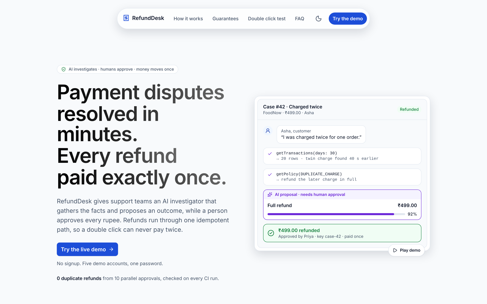

---

## Demo

**[▶ Watch the end to end demo (1 min 52 s)](docs/demo.mp4)**: landing page → customer reports a double charge → AI proposal → ops note → approver approves → refunded once → audit log → customer sees the refund → admin. Recorded by Playwright against the real stack (MongoDB, Redis, API, web) in the `demo-video` workflow; rerun it to refresh the video and screenshots.

| | | |
| --- | --- | --- |
| 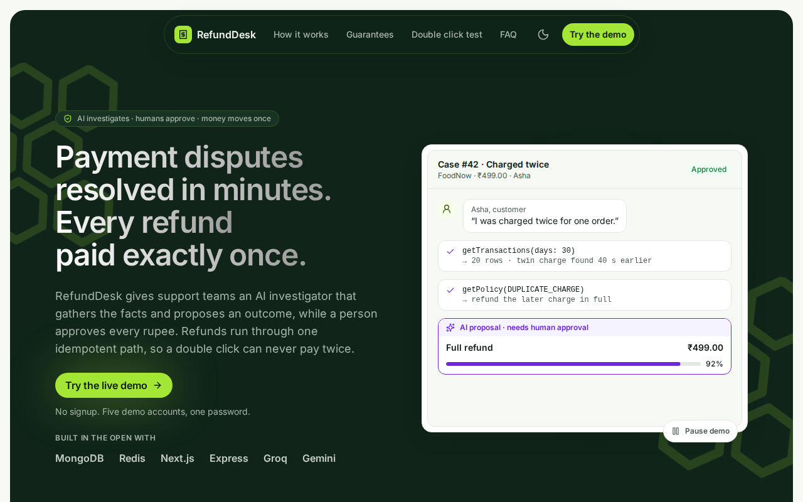 Landing page | 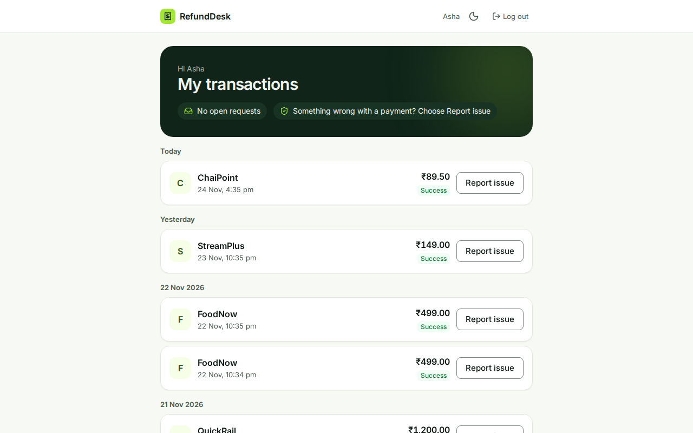 Customer transactions | 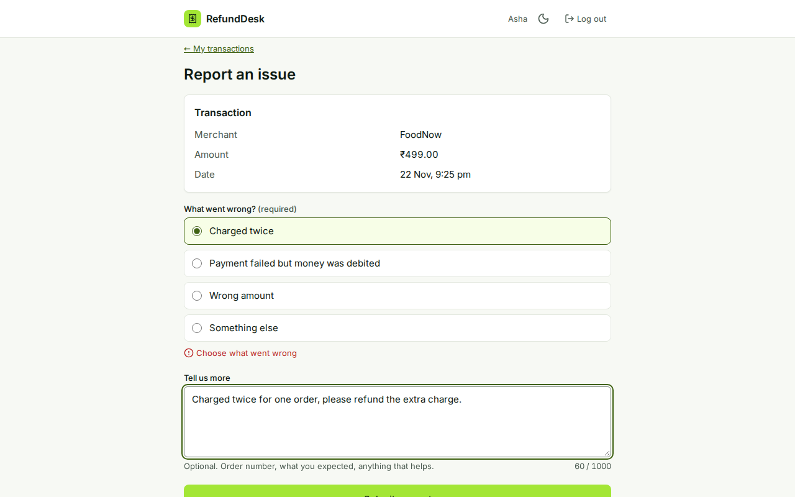 Report an issue |
| 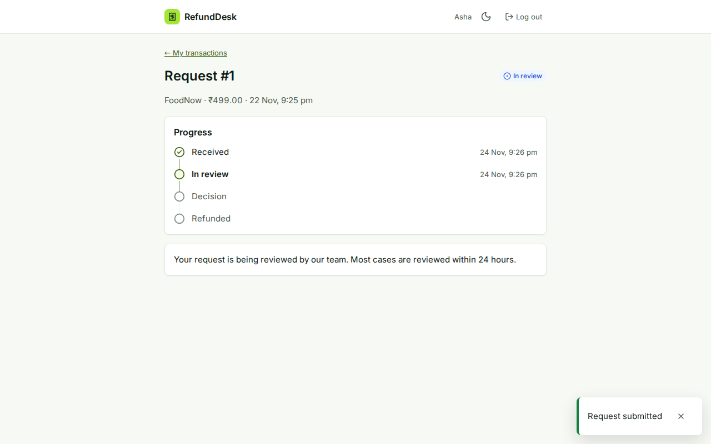 Case in review | 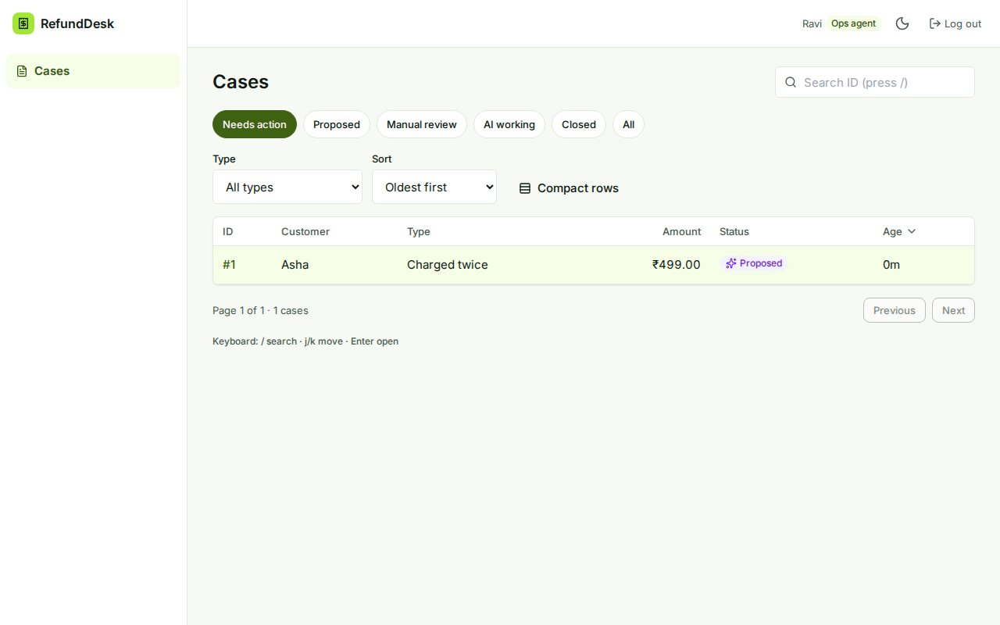 Ops case queue | 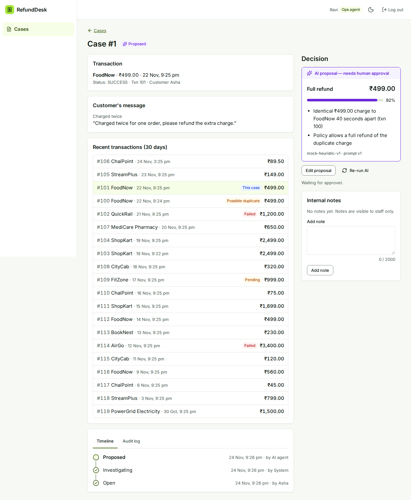 AI proposal |
| 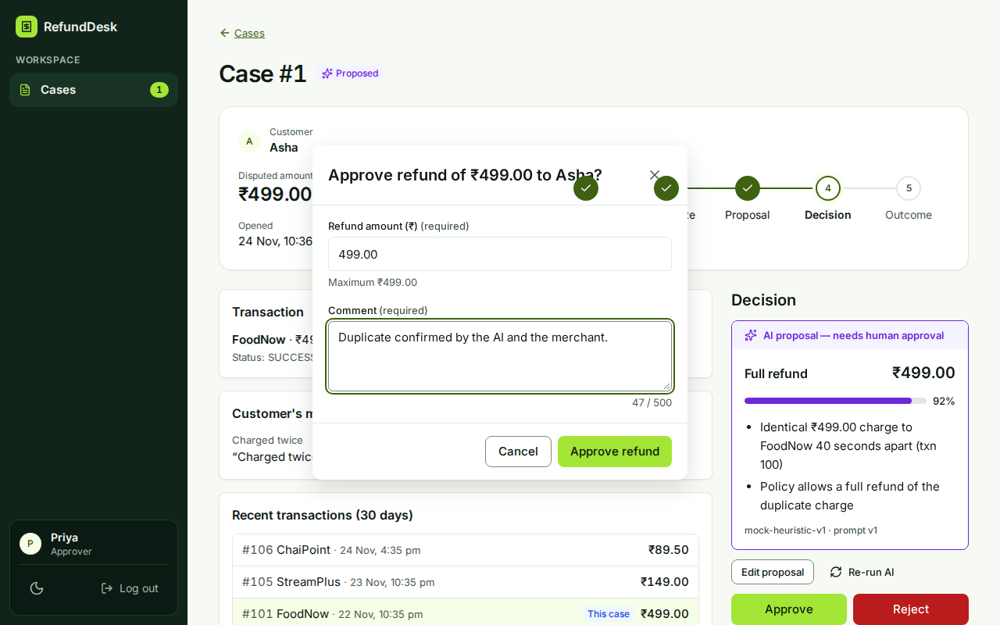 Approve dialog | 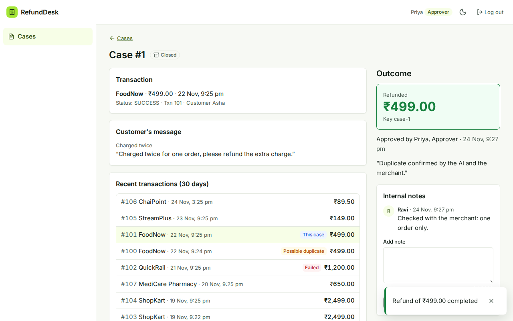 Refunded once | 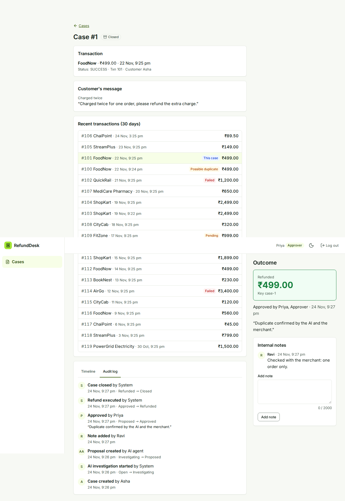 Audit log |
| 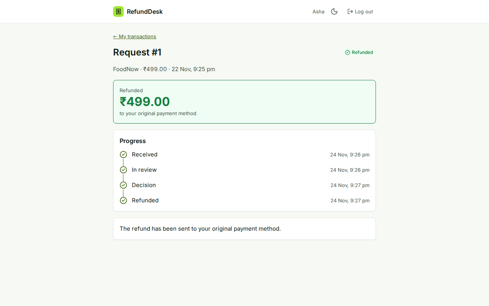 Customer sees refund | 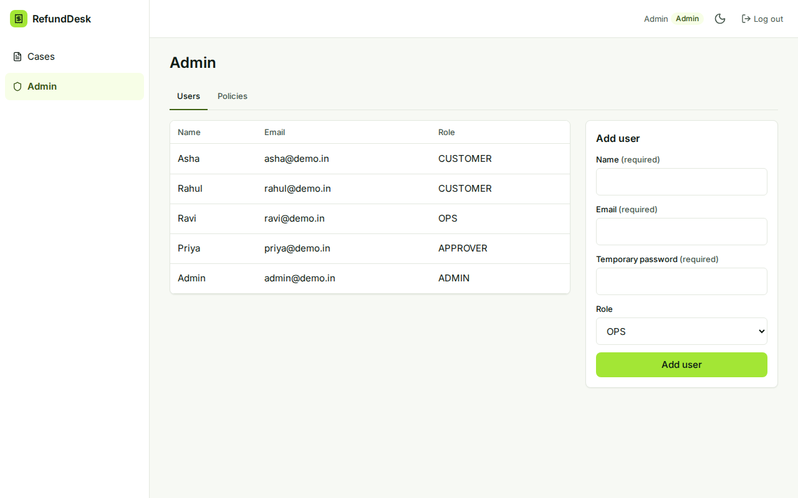 Admin | 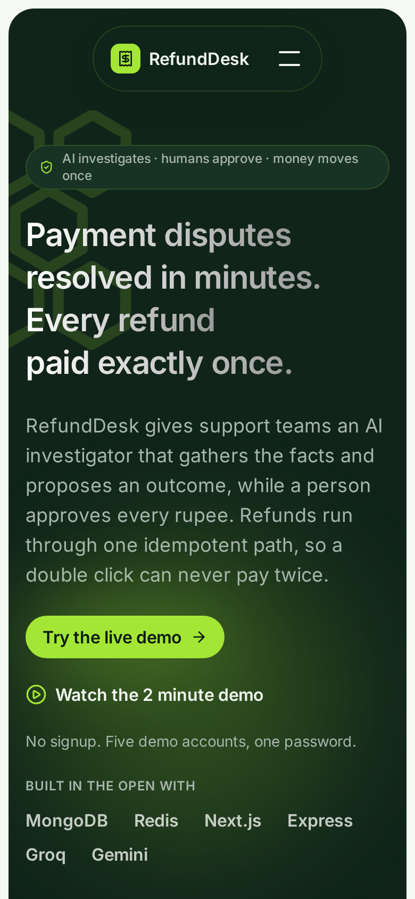 Mobile |

All 25 screens are in [`docs/screens`](docs/screens).

## Why it exists

Customers with a duplicate or failed-but-debited payment have no clear way to report it. Support teams investigate every case by hand, and a wrong or duplicate refund is real money lost. RefundDesk:

1. lets customers raise a dispute against a specific transaction and track it,
2. has an AI agent gather facts (transaction history, policy) and propose an outcome with reasons and confidence,
3. guarantees **no refund without human approval**, and **each refund executes exactly once**,
4. keeps a complete, append-only audit trail of every action.

## Architecture

```
┌──────────────────── Next.js app (Tailwind, TanStack Query) ───────────────────┐
│   Customer portal  /            Ops console  /ops      (one accessible kit)    │
└───────────────────────────────────────┬───────────────────────────────────────┘
                                        │ HTTPS + Bearer JWT
┌──────────────────────── Express API (modular monolith) ───────────────────────┐
│ security → auth · transaction · casemgmt ──► refund (idempotent)              │
│                                   │   ▲                                        │
│                     enqueue after │   │ proposal draft (read-only agent)       │
│                           commit  ▼   │                                        │
│              Redis / BullMQ ──► agent worker ──► LLM (Groq / Gemini / Ollama)  │
│ audit (append-only) · policy (Redis-cached) · metrics (Prometheus)             │
└───────────────┬───────────────────────────────────────────────┬───────────────┘
                │ Mongoose (replica set → transactions)          │ ioredis
          ┌─────▼─────┐                                    ┌─────▼─────┐
          │  MongoDB  │                                    │   Redis   │
          └───────────┘                                    └───────────┘
```

**Case lifecycle:** `OPEN → INVESTIGATING → PROPOSED → APPROVED → REFUNDED → CLOSED`, with `NEEDS_MANUAL_REVIEW` when the AI fails and `REJECTED → CLOSED` on rejection. Every transition goes through one state machine and writes its audit entry in the **same MongoDB transaction**.

### Safety guarantees and where they live

| Guarantee | How | Code |
| --- | --- | --- |
| No refund without approval | Only `DecisionService` calls `refundService.execute`; enforced by a test | `backend/src/modules/casemgmt/decision.service.ts`, `test/unit/architecture.test.ts` |
| Refund exactly once | Key `case-{id}` + unique index; duplicate insert returns the original row | `backend/src/modules/refund/refund.service.ts` |
| Double-click safe | Optimistic lock on `version`; unique decision per case | `caseTransitions.ts`, `decision.model.ts` |
| AI is read-only | Agent module cannot import refund / casemgmt / models at runtime | `architecture.test.ts` |
| Never trust LLM output | Schema, enum and amount ≤ transaction checks in code; one retry, then manual review | `agent/proposalValidator.ts`, `agent/agent.service.ts` |
| Prompt injection | Customer text wrapped in `<case_data>` as JSON; delimiter escapes removed | `agent/prompt/promptBuilder.ts` |
| Hard limits | ≤ 3 LLM requests per case (retries included), temperature 0.1, 20 s timeout | `agent/agent.service.ts` |
| Complete audit | Append-only collection; update/delete hooks throw | `audit/audit.model.ts` |
| Money precision | Integer paise everywhere; rupees only at the API edge | `common/money.ts` |

The original design docs targeted Java/Spring + PostgreSQL. [`docs/STACK.md`](docs/STACK.md) maps every decision to this stack.

## Features

**Landing page (`/`)**: forest green + lime brand · dark rounded hero with drifting hexagon art and a live demo of one case going from report to refund (pausable, static under reduced motion) · problem section with a pulsing radar and CI stats that count up · glowing agent hub where the case flow lights up node by node · role cards · guarantees bento with a highlighter sweep on headings · process line that draws itself on scroll · word by word tagline reveal · interactive double click test where the ledger never passes one refund · FAQ with schema.org markup · circuit line CTA · giant wordmark footer.

**Customer portal (`/transactions`)**: transactions grouped by day · report an issue · case status timeline (Received → In review → Decision → Refunded) · outcome card · polls while the AI works · live-region announcements.

**Ops console (`/ops`)**: case queue with status chips, type filter, sort, pagination, overdue flag, `/` `j` `k` `Enter` shortcuts, compact rows · case detail with transaction, customer message, related transactions with "Possible duplicate", AI proposal card with confidence and reasons, manual proposal editor, re-run AI, notes, timeline and audit tabs · approver-only Approve / Reject dialogs with amount cap, required comment and conflict handling · admin users and policy rules.

**Accessibility:** WCAG 2.1 AA target: semantic HTML, visible focus ring, skip link, page title + focus on route change, labelled fields with linked errors, status never colour-only, focus-trapped dialogs, roving-tabindex tabs, `aria-sort` tables, reduced-motion and dark mode. Every UI component has an axe test.

## Run locally

Requirements: Node 22+, Docker (for MongoDB and Redis).

```bash
cp .env.example .env            # set JWT_SECRET to 32+ random characters
docker compose up -d mongo redis
npm install
npm run seed                    # demo users, policies, ~30 transactions
npm run dev:api                 # http://localhost:8080 (runs the agent worker in-process)
npm run dev:web                 # http://localhost:3000
```

Or the whole stack in containers:

```bash
docker compose up --build
docker compose exec api node dist/seed/run.js
```

`LLM_PROVIDER=mock` (the default) uses a deterministic offline investigator, so the full flow works with no API key. Set `LLM_PROVIDER=groq` (or `gemini` / `ollama`), `LLM_API_KEY` and `LLM_MODEL` to use a real model.

### Demo accounts

Password for all: `Demo@123`

| Role | Email |
| --- | --- |
| Customer | `asha@demo.in` |
| Customer (second, for ownership checks) | `rahul@demo.in` |
| Ops agent | `ravi@demo.in` |
| Approver | `priya@demo.in` |
| Admin | `admin@demo.in` |

Try it: open http://localhost:3000, choose **Try the live demo**, log in as Asha → report "Charged twice" on the FoodNow ₹499 payment → log in as Priya at `/ops` → open the case → Approve → Asha sees "₹499.00 refunded".

## Tests

| Command | What it covers | Needs |
| --- | --- | --- |
| `npm test -w backend` | State machine (every valid/invalid transition), money, JWT, proposal validator, agent loop with `FakeLlmClient` (tools, scoping, invalid JSON retry, amount cap, 429 backoff, timeouts, call limit, injection), architecture rules | nothing |
| `npm run test:it -w backend` | Login + rate limit, ownership (404 not 403), full lifecycle, double-submit → one refund, 10 parallel refunds → one row, every endpoint × every role, AI outage → manual review | MongoDB replica set + Redis |
| `npm run test:eval -w backend` | 22 labelled cases; target ≥ 80% matching action | `LLM_*` env for a real model |
| `npm test -w frontend` | Component behaviour (RTL), keyboard, focus trap, axe, IST/INR helpers, customer timeline | nothing |

CI (`.github/workflows`) runs all of the above, with MongoDB and Redis as containers. Latest run: 133 unit, 96 integration and 30 frontend tests passing.

**Eval score:** 22/22 with the offline `mock` provider. That provider is a heuristic, so this only proves the harness; record the real model's score here once it has run.

| Live hero demo | Double click test |
| --- | --- |
|  | 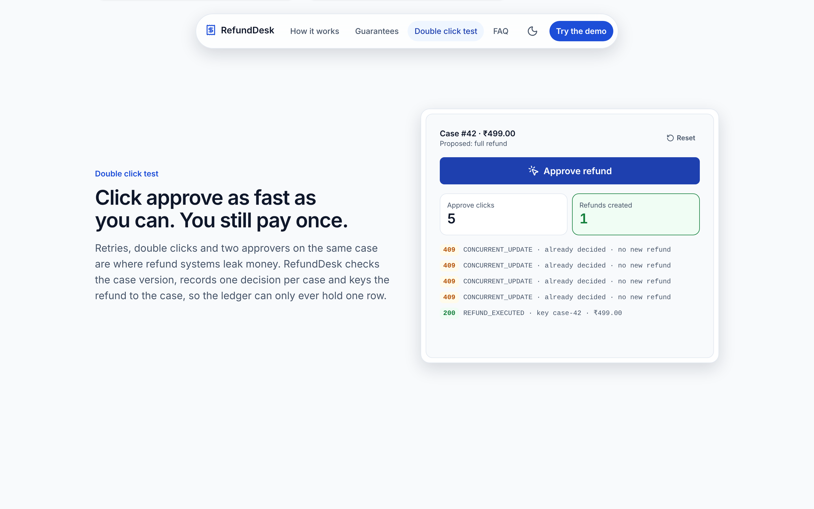 |

## Configuration

See [`.env.example`](.env.example). Key variables: `MONGODB_URI` (must be a replica set), `REDIS_URL`, `JWT_SECRET`, `CORS_ALLOWED_ORIGINS`, `LLM_PROVIDER`, `LLM_API_KEY`, `LLM_MODEL`, `RUN_WORKER_INLINE`, `NEXT_PUBLIC_API_BASE_URL`.

## Deployment (free tiers)

| Piece | Option |
| --- | --- |
| API + worker | Any Docker host (Render, Fly.io, Railway) using `backend/Dockerfile`; worker command `node dist/worker.js`, or `RUN_WORKER_INLINE=true` on a single instance |
| Database | MongoDB Atlas (replica set by default) |
| Redis | Upstash or Redis Cloud |
| Web | Vercel (root `frontend`, env `NEXT_PUBLIC_API_BASE_URL`) or `frontend/Dockerfile` |

Health check: `GET /actuator/health`. Metrics: `GET /actuator/prometheus` (ADMIN token).

## Repository layout

```
backend/          Express API, agent worker, tests (unit, integration, eval)
  src/modules/    user · auth · transaction · policy · casemgmt · agent · refund · audit · admin
  resources/prompts/refund-investigator-v1.txt
frontend/         Next.js app: landing page (/), customer portal (/transactions) and ops console (/ops)
  src/components/ui/   presentational component kit (tokens only)
docs/             PRD, TRD, Design, Rules, Phases, STACK (stack mapping)
CLAUDE.md         Project rules for AI coding assistants
```

## Status and known gaps

- Storybook (Phase 3) isn't set up yet. Components are covered by RTL and axe tests.
- Notifications, refresh tokens, Playwright E2E and the agent-accuracy dashboard are backlog items (see `docs/Phases.md`).

## License

MIT © M N Santhi Swarup
